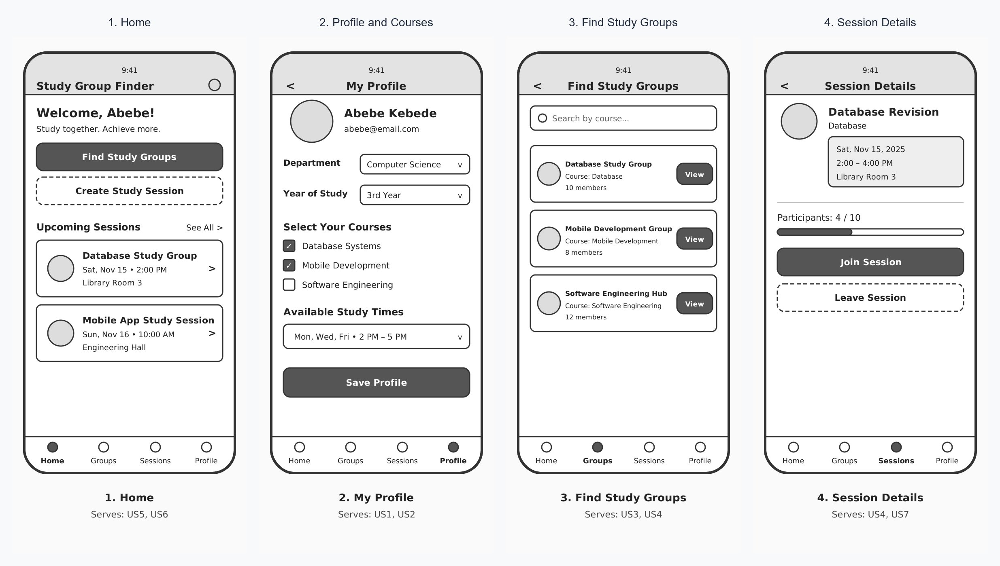

# Project Proposal

## 1. Title and One-Sentence Description

**Project Title: Study Group Finder**

Study Group Finder is a mobile application that helps university students find classmates taking the same courses, organize study sessions and generate AI-assisted study plans so that they can study together more effectively.

## 2. Group

| **Name** | **Role** |
|---|---|
| Lidiya Aramde | **Backend and AI Engineer:** Develop the FastAPI backend, design REST API endpoints, integrate Google Gemini for the AI Study Planner and implement the study-group matching algorithm. |
|  Tesnim Hussien| **Authentication and Data Management:** Implement Firebase Authentication, student profiles, course selection, availability management, Cloud Firestore integration and security rules. |
|Ruth Zelalem  | **Study Groups and Session Management:** Implement study-group management, study-session creation, joining and leaving sessions, session details and device location functionality with permission handling. |
| Tsion Bizuayehu | **Flutter Application and Integration:** Develop the main Flutter screens, navigation using go_router, application state management using Riverpod, integrate feature screens and coordinate application testing. |

These roles represent primary responsibilities. All four members will contribute to the frontend, backend, testing, integration and documentation.

## 3. The Problem

University students often need to study with classmates to understand difficult course topics, prepare for examinations and share knowledge. However, finding students who take the same courses and have compatible study schedules can be challenging. Students commonly depend on friends, class group chats and informal communication to find study partners and organize study sessions. These methods do not always make it easy to discover suitable groups or keep track of planned study activities.

This problem is relevant to students at Addis Ababa University, where students may want to find classmates for specific courses, arrange group study sessions and prepare together for examinations. Study Group Finder will provide a centralized mobile platform where students can discover study groups, organize sessions and access study-planning assistance. A mobile application is suitable because students can access these features from their phones and manage their study activities conveniently.

**Potential user:** Rediet Assefa, a 4th-year Computer Science student at Addis Ababa University. In a conversation, this student explained that finding classmates who share the same course sections and compatible study schedules is difficult; coordinating study sessions across various informal Telegram group chats often leads to missed messages and disorganized meeting locations on campus. This feedback will help us understand the problem and ensure that the application addresses a real student need.

## 4. Users

1. **Students looking for study partners:** University students who want to find classmates taking the same courses. They need to browse study groups and find compatible students. They may use the application several times a week.

2. **Students organizing study sessions:** Students who want to arrange group study activities for a particular course or topic. They need to create sessions, select meeting places and manage participation. They may use the application whenever they organize a session.

3. **Students preparing for examinations:** Students who want to organize their study time and divide difficult topics into manageable tasks. They need an AI-assisted study planner to generate study agendas. They may use this feature regularly, especially before examinations.

## 5. User Stories

1. As a student, I want to register and log in so that I can securely access my account. (**must**)

2. As a student, I want to create my profile and select my courses and available study times so that I can find compatible study partners. (**must**)

3. As a student, I want to browse study groups based on shared courses so that I can find classmates studying the same subjects. (**must**)

4. As a student, I want to create a study session with a topic, date, time and meeting place so that I can organize group study activities. (**must**)

5. As a student, I want to join or leave a study session so that I can participate in sessions that fit my schedule. (**must**)

6. As a student, I want to view my upcoming study sessions so that I can keep track of my planned study activities. (**should**)

7. As a student, I want to generate an AI-assisted study plan for a selected topic so that I can organize my study time more effectively. (**should**)

## 6. Screens

| **Screen** | **Purpose** | **User stories** |
|---|---|---|
| Login and Registration | Allows students to create accounts and log in. | 1 |
| Home | Displays a summary of available study groups and upcoming sessions. | 3, 6 |
| Profile and Courses | Allows students to manage their profiles, select courses and set availability. | 2 |
| Find Study Groups | Displays relevant study groups based on selected courses and compatibility. | 2, 3 |
| Create Study Session | Allows students to create sessions by entering a topic, date, time and meeting place. | 4 |
| Session Details | Displays session information and allows students to join or leave. | 5 |
| AI Study Planner | Generates a study agenda based on the student's topic, available time and learning goal. | 7 |

### Four Main Screen Sketches

The four main screens are Home, Profile and Courses, Find Study Groups, and Session Details.



## 7. Data Model

The application will use the following main entities:

```text
User:
id, name, email, department, yearOfStudy

Course:
id, courseCode, courseName

UserCourse:
id, userId, courseId

Availability:
id, userId, dayOfWeek, startTime, endTime

StudyGroup:
id, name, courseId, description, creatorId

StudySession:
id, groupId, topic, date, startTime,
meetingPlace, latitude, longitude, organizerId

SessionMember:
id, sessionId, userId, joinedAt
```

**Relationships:**

- A user can select multiple courses, and a course can have multiple students. UserCourse connects users and courses.
- A user can have multiple availability periods.
- A course can have multiple study groups.
- A study group can contain multiple study sessions.
- A user can organize multiple study sessions.
- Multiple users can join a study session through SessionMember.

AI-generated study plans will be generated from the student's input and returned to the application. They do not require a separate permanent database entity in the initial version.

## 8. Data Sources

The application will use local persistence, a REST web service and Firebase.

**1. Local Persistence – SharedPreferences**

SharedPreferences will store small local settings, such as user preferences and selected search filters. This allows these settings to remain available when the application is reopened. Sensitive account information will not be stored in SharedPreferences.

**2. REST Web Service – FastAPI**

The group will develop a REST API using FastAPI. It will provide the course catalog and backend functionality for study-group matching and AI study-plan generation.

The API will expose endpoints for retrieving courses, requesting study-group recommendations and generating study plans. The Flutter application will communicate with the service through HTTP requests and JSON responses.

**3. Firebase – Authentication and Cloud Firestore**

- **Firebase Authentication:** Handles student registration and login.
- **Cloud Firestore:** Stores and retrieves student profiles, selected courses, availability, study groups, study sessions and session memberships.

Each data source will be accessed through repository interfaces to separate the application's business logic from the data implementation.

## 9. Device Feature and AI Feature

### Device Feature: Location

The application will use the device's location when a student creates a study session and chooses to use their current location as the meeting place.

This feature supports user story 4. The application will request location permission only when the student chooses to access their current location.

The application will handle the following situations:

- **Permission granted:** The current location can be retrieved and used as the meeting place.
- **Permission denied:** The student can enter a meeting place manually.
- **Permission permanently denied:** The student will be guided to the device settings if they want to enable location access.
- **Location services disabled or unavailable:** The student can enter a meeting place manually.

Location will only be accessed when the student requests the feature.

### AI Feature: AI Study Planner

The application will provide an AI-powered study planner that generates a study agenda for a selected topic.

The student will provide:
- The subject or topic to study.
- The available study time.
- The learning goal.

This feature supports user story 7. The information will be sent to the group's FastAPI backend, which will communicate with the Google Gemini API and return a generated study plan.

Students will be informed that their submitted topic, available time and learning goal are sent to Google Gemini through the backend. Passwords and private account information will not be sent. The Gemini API key will be stored securely on the backend rather than inside the Flutter application. Students will be able to choose whether to use the AI feature.

## 10. Risks

| **Risk** | **Likelihood** | **Plan** |
|---|---|---|
| Internet connection or backend service becomes unavailable. | Medium | Display an appropriate error message and allow users to retry. |
| Gemini API becomes unavailable or reaches its usage limit. | Medium | Handle API errors and provide a basic manual study-planning alternative. |
| Students deny location permission or disable location services. | Medium | Allow students to enter meeting places manually. |
| Integration problems occur when combining features developed by different members. | Medium | Agree on data models and API interfaces early, use Git branches and integrate regularly. |
| Academic schedules reduce the time available for development. | Medium | Divide responsibilities clearly, set weekly targets and prioritize must-have features. |

## 11. Milestone Plan

### Milestone 1 – End of Week 6: Screens, Navigation and State

**User stories planned for completion:** Stories 1, 2, 3, 4, and 5 (to be demonstrated with sample data and in-memory state).

- Set up the Flutter project using the required feature-first structure.
- Create all application screens.
- Implement navigation using go_router.
- Set up Riverpod for application state management.
- Define immutable models using Freezed.
- Establish repository interfaces and agree on API contracts.
- Implement the main user flows using sample data and in-memory state.
- Demonstrate registration (Story 1), profile setup (Story 2), browsing study groups (Story 3), and creating or joining sessions (Stories 4 and 5).

### Milestone 2 – End of Week 10: Data, Backend and Tests

**User stories planned for completion:** Stories 1, 2, 3, 4, 5, and 6 (to be fully integrated with live data and local storage), and Story 7 (AI study planner backend integration).

- Integrate Firebase Authentication and Cloud Firestore for user profiles, courses, and session data (Stories 1, 2, 3, 4, 5).
- Develop and integrate the FastAPI course catalog and matching algorithm (Story 3).
- Implement local persistence using SharedPreferences for user settings and filter preferences.
- Implement upcoming session tracking (Story 6).
- Add the device location feature with permission handling for meeting places (Story 4).
- Integrate the AI Study Planner with Google Gemini through the backend (Story 7).
- Add unit and widget tests and begin integration testing.

### Final Submission – End of Week 14

**User stories planned for completion:** All user stories (Stories 1, 2, 3, 4, 5, 6, and 7) fully complete, polished, and tested.

- Complete all user stories, edge cases, and application functionality.
- Finish integration and resolve major bugs.
- Complete unit, widget and integration tests, achieving at least 60% line coverage.
- Configure development and production build flavours with separate application IDs.
- Ensure the application passes `flutter analyze --fatal-infos`.
- Complete README.md, AI_USAGE.md, PRIVACY.md and USER_TEST.md.
- Build and sign the production APK or AAB and attach it to the final Git tag.

## 12. AI-Use Plan

The group intends to use AI tools responsibly as learning and development support while following the course AI policy in `../syllabus/policies.md`.

Planned uses include:

- **Learning:** Understanding unfamiliar Flutter, Dart, Firebase, Python and backend concepts.
- **Code assistance:** Getting explanations of errors and suggestions for improving code where permitted by the course policy.
- **Boilerplate:** Using AI assistance for repetitive setup tasks only when permitted.
- **Testing:** Understanding testing techniques and reviewing test cases where permitted.
- **Documentation:** Organizing technical documentation and checking explanations for accuracy.

All AI-generated suggestions will be reviewed, understood and tested by group members. The group will not use AI in ways prohibited by the course policy. Each member will disclose AI use according to the course requirements.